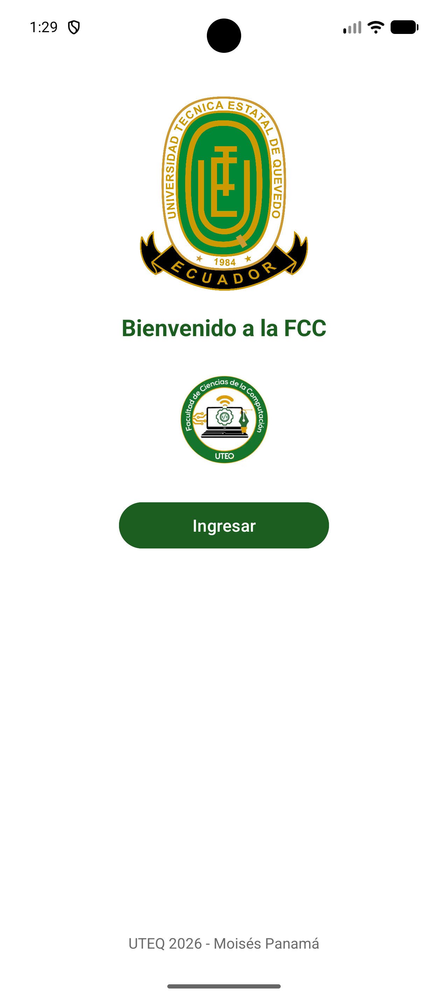
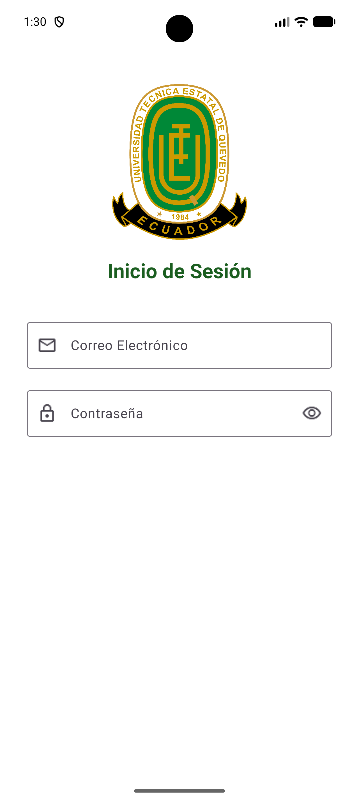

# Práctica 1 – Pantalla de bienvenida e inicio de sesión

**Estudiante:** Moisés Panamá · mpanamam@uteq.edu.ec  
**Asignatura:** Aplicaciones Móviles – UTEQ 2026  
**Repositorio:** [Practica-1-pantalla-de-bienvenida-e-inicio-de-sesi-n](https://github.com/MoisesPanama/Practica-1-pantalla-de-bienvenida-e-inicio-de-sesi-n)

Aplicación Android desarrollada en Kotlin con dos pantallas: una **bienvenida** con los logos de la UTEQ y de la Facultad de Ciencias de la Computación (FCC), y un **inicio de sesión** con correo y contraseña usando Material Components. El botón **Ingresar** abre la pantalla de login.

## Objetivo de la práctica

Aplicar los conceptos básicos de Android vistos en clase:

- Construir interfaces con `ConstraintLayout`.
- Navegar entre pantallas mediante `Intent` y `Activity`.
- Usar componentes de Material Design (`TextInputLayout` y `TextInputEditText`).
- Manejar la entrada de texto y la visibilidad de una contraseña.

## ¿Qué hace?

- **Pantalla de bienvenida:** muestra el logo de la UTEQ, el logo de la FCC, un mensaje de bienvenida y el botón para ingresar al inicio de sesión.
- **Inicio de sesión:** presenta campos de correo y contraseña con íconos, teclado adecuado para cada campo y un botón para mostrar u ocultar la contraseña.
- **Navegación:** al presionar **Ingresar** se abre la segunda pantalla mediante un `Intent`.

## Flujo de la aplicación

```text
MainActivity (Bienvenida)
        │
        │  Botón "Ingresar"
        ▼
LoginActivity (Inicio de sesión)
```

## Funcionalidades

- [x] Logo de la UTEQ en la pantalla de bienvenida.
- [x] Logo de la Facultad de Ciencias de la Computación.
- [x] Mensaje de bienvenida y botón para continuar.
- [x] Navegación de la bienvenida al login con `Intent`.
- [x] Campo de correo con ícono y teclado de tipo email.
- [x] Campo de contraseña con ícono de candado.
- [x] Mostrar y ocultar la contraseña con íconos de ojo.
- [x] Diseño responsivo básico con `ConstraintLayout`.

## Tecnologías

| Tecnología | Uso en el proyecto |
| --- | --- |
| Kotlin | Lenguaje de programación de las Activities. |
| Android Studio | Entorno de desarrollo. |
| ConstraintLayout | Organización de los elementos de las pantallas. |
| Material Components | Campos de texto y botón con estilo Material 3. |
| Android SDK 37 | `compileSdk` y `targetSdk` del proyecto. |
| minSdk 24 | Compatibilidad desde Android 7.0. |

## Requisitos

- Android Studio instalado.
- JDK 11 (configurado en el proyecto).
- Android SDK 37.
- Emulador o dispositivo físico con Android 7.0 (API 24) o superior.

## Estructura del proyecto

```text
Practica1/
├── app/src/main/
│   ├── java/com/example/practica1/
│   │   ├── MainActivity.kt       # Pantalla de bienvenida
│   │   └── LoginActivity.kt      # Pantalla de inicio de sesión
│   ├── res/
│   │   ├── drawable/
│   │   │   ├── logo.png             # Logo de la UTEQ
│   │   │   ├── logo_facultad.jpg    # Logo de la FCC
│   │   │   ├── mail.png             # Ícono de correo
│   │   │   ├── lock.png             # Ícono de contraseña
│   │   │   ├── visibility.png       # Mostrar contraseña
│   │   │   └── visibility_off.png   # Ocultar contraseña
│   │   ├── layout/
│   │   │   ├── activity_main.xml
│   │   │   └── activity_login.xml
│   │   └── values/
│   │       ├── colors.xml
│   │       ├── strings.xml
│   │       └── themes.xml
│   └── AndroidManifest.xml
├── evidencias/
│   ├── bienvenida.png
│   └── login.png
├── README.md
└── build.gradle.kts
```

## Recursos gráficos

| Recurso | Descripción |
| --- | --- |
| `logo.png` | Escudo de la Universidad Técnica Estatal de Quevedo. |
| `logo_facultad.jpg` | Logo de la Facultad de Ciencias de la Computación. |
| `mail.png` | Ícono del campo de correo electrónico. |
| `lock.png` | Ícono del campo de contraseña. |
| `visibility.png` | Ícono para mostrar la contraseña. |
| `visibility_off.png` | Ícono para ocultar la contraseña. |

## Cómo ejecutar

1. Clona el repositorio:
   ```bash
   git clone https://github.com/MoisesPanama/Practica-1-pantalla-de-bienvenida-e-inicio-de-sesi-n.git
   ```
2. Abre la carpeta del proyecto en Android Studio.
3. Espera a que Gradle sincronice las dependencias.
4. Ejecuta la app en un emulador o dispositivo con **Run ▶**.

También puedes compilar desde la terminal:

```bash
# Windows
.\gradlew.bat assembleDebug

# Linux / macOS
./gradlew assembleDebug
```

El APK de depuración se genera en:

```text
app/build/outputs/apk/debug/app-debug.apk
```

## Evidencias

| Bienvenida | Inicio de sesión |
|:---:|:---:|
|  |  |

## Alcance de la práctica

- El proyecto corresponde únicamente a la interfaz de bienvenida e inicio de sesión.
- No incluye autenticación real, base de datos ni conexión con un servidor.
- Los campos del login son demostrativos y no validan credenciales.

## Verificación

- Compilación correcta con `.\gradlew.bat assembleDebug`.
- Análisis de lint sin errores.
